# Roadmap de Ukuk: qué está hecho, cómo se probó y qué sigue

*Actualizado: 13 de octubre de 2026.*

## En 30 segundos

- **Qué es:** cuatro servicios antifraude y de cumplimiento para seguros, banca, cajas y otros
  sujetos obligados en el Perú: verificación documental, PLAFT, radar regulatorio y siniestros por
  WhatsApp.
- **Dónde estamos:** el software de los cuatro servicios ya existe como **prototipo funcional**,
  con página pública, portal para analistas y datos de demostración. Corre en tu Mac con un
  comando.
- **Lo que todavía no sabemos:** si detecta fraudes reales. Las pruebas comprueban que el código
  hace lo que se escribió, no que encuentre falsificaciones bien hechas (ver
  [Qué prueban y qué no](#qué-prueban-y-qué-no)). Hay que medirlo con documentos que tengan fraude
  confirmado.
- **Lo que falta no es técnico:** el negocio está en la fase 0 de la propuesta (validar con
  clientes). Lo siguiente es revisar tu contrato laboral, hacer las 10 entrevistas y conseguir una
  carta de intención para un piloto pagado.

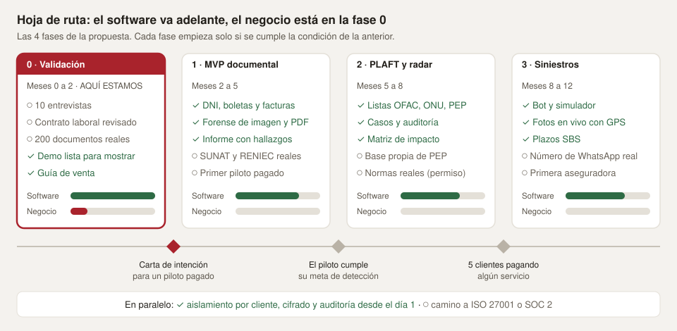

✓ = construido (falta medir su detección con fraudes reales) · ○ = pendiente

## Lo que se ve hoy

### Página pública

Explica la oferta, deja probar el análisis con documentos de muestra y recibe pedidos de piloto. No
publica precios: todavía son hipótesis.

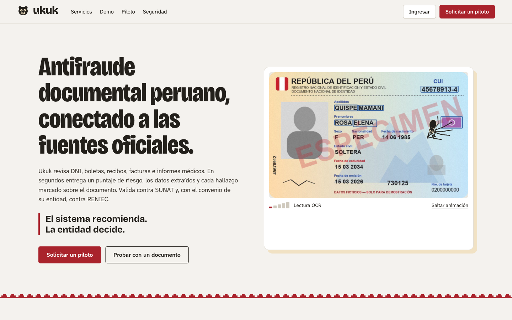

### El inspector araña

Mientras se analiza un documento, una araña recorre el texto que leyó el OCR y deja marcado cada
hallazgo: **rojo** = anomalía, **ámbar** = revisar, **azul** = dato extraído. Sirve como barra de
progreso y luce en una demo.

| Boleta retocada: el total no cuadra (rechazar) | DNIe con el número cambiado (revisar) |
|---|---|
| 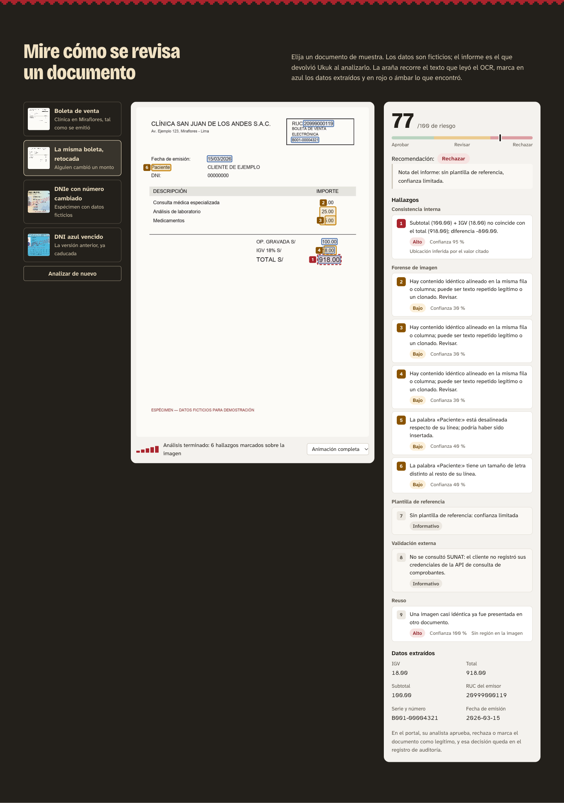 | 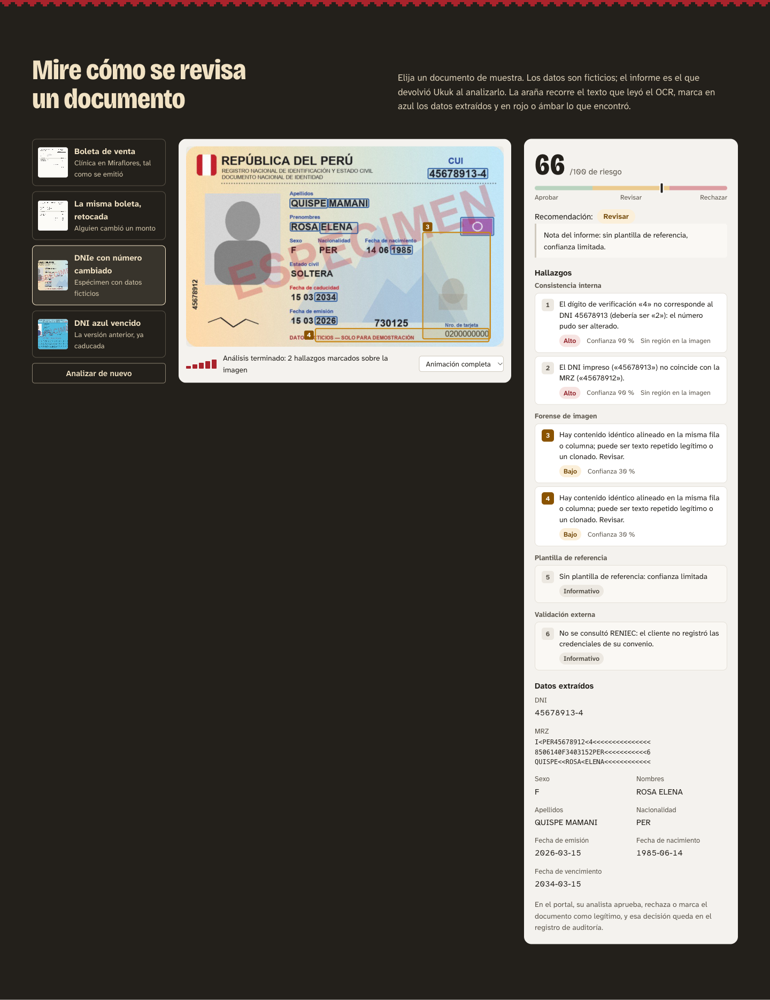 |

| DNI azul vencido (revisar) |
|---|
| 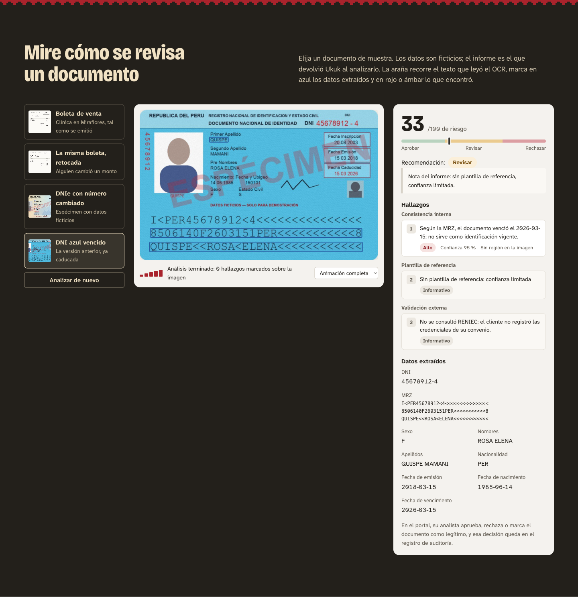 |

Los DNI de muestra imitan el diseño del DNIe 3.0 y del DNI azul anterior, con **datos
ficticios** y la marca "ESPÉCIMEN". No copian el escudo ni los elementos de seguridad reales.

### Portal para analistas

| Informe de un documento | Caso PLAFT con su coincidencia |
|---|---|
| 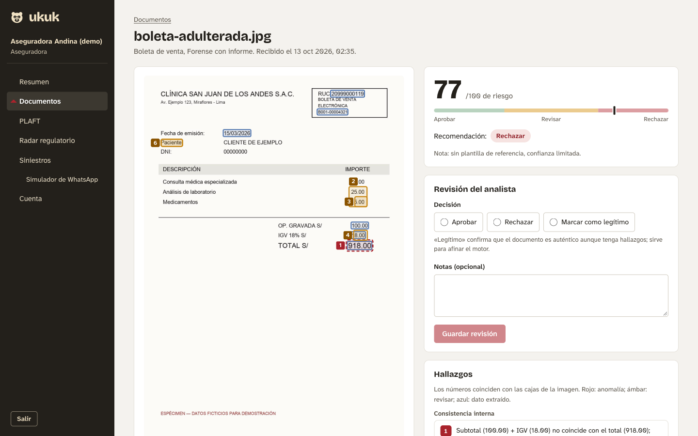 | 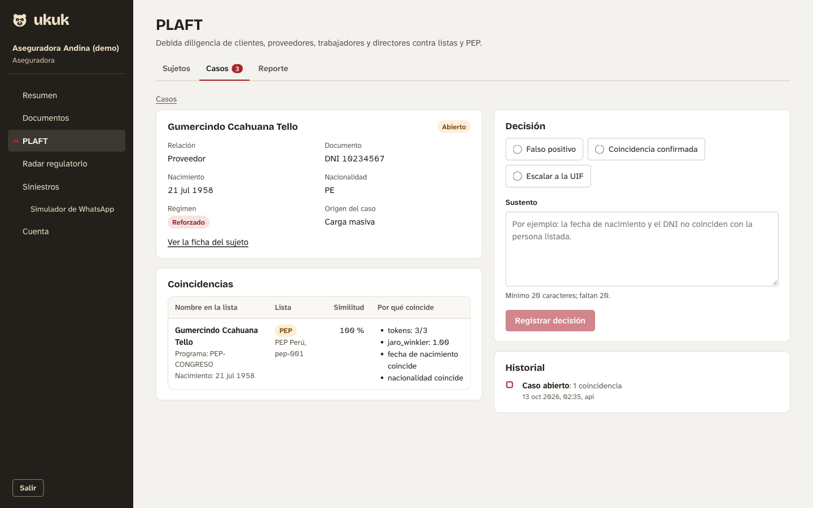 |

| Matriz de impacto regulatorio | Siniestro con plazos SBS |
|---|---|
| 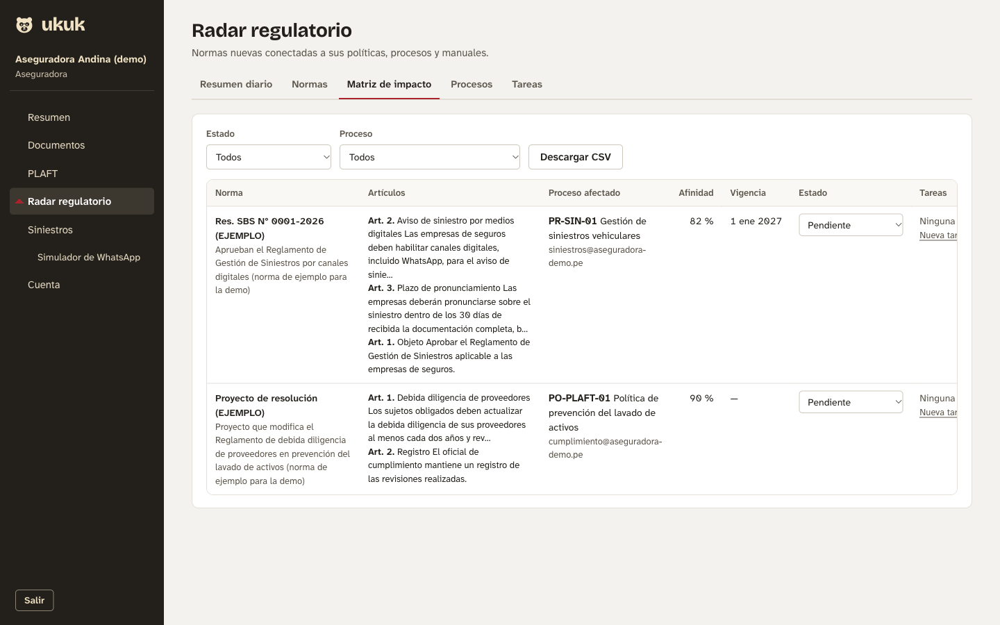 | 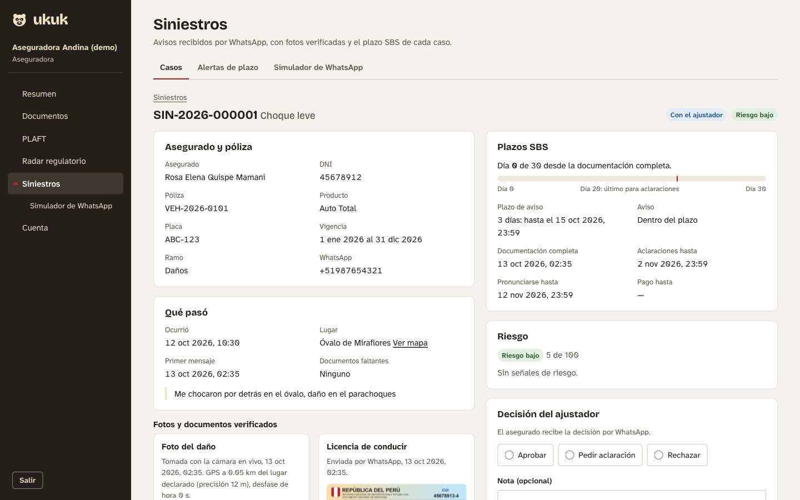 |

| Simulador de WhatsApp (sin cuenta de Meta) | Cuenta: consumo y auditoría verificable |
|---|---|
| 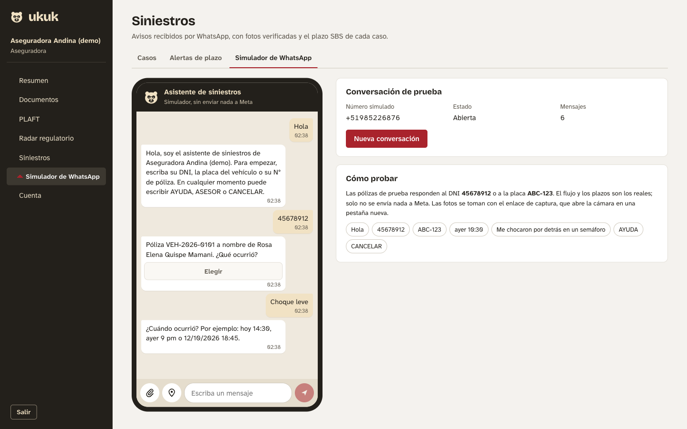 | 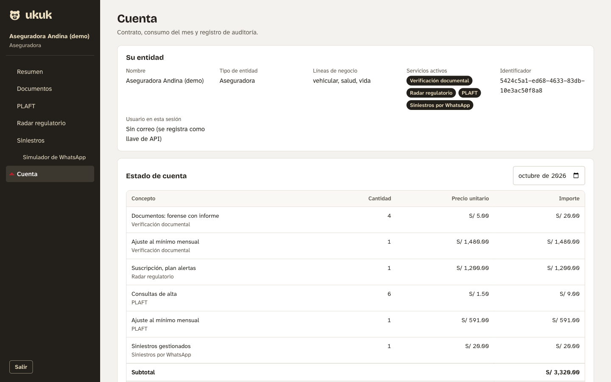 |

También funciona en el celular:

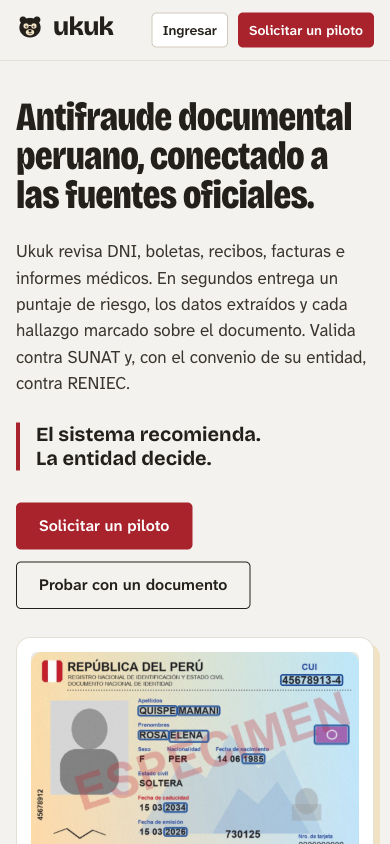

## Lo que se construyó

### Etapa 1: los cuatro servicios

| Servicio | Qué hace hoy |
|---|---|
| **1. Verificación documental** | Puntaje de riesgo de 0 a 100 y una recomendación (aprobar, revisar, rechazar), con cada hallazgo marcado. Detecta: zonas pegadas o clonadas, compresión distinta, edición con Photoshop, PDF modificado, sumas e IGV que no cuadran, MRZ del DNI que no coincide con lo impreso, dígito del CUI incorrecto, DNI vencido, y archivos o fotos reusados. |
| **2. Radar regulatorio** | Separa normas generales de particulares, las cruza con los procesos del cliente y arma la matriz de impacto, el resumen diario, las tareas y el borrador de comentarios. |
| **3. PLAFT** | Revisa personas y empresas contra OFAC, ONU y listas PEP (pensado para nombres peruanos). Abre casos, asigna el régimen de debida diligencia, guarda la decisión con su sustento y vuelve a revisar la cartera cada noche. |
| **4. Siniestros por WhatsApp** | Conversación guiada, fotos en vivo con GPS y hora, plazos de la SBS y revisión del analista antes del ajustador. |

Debajo de los cuatro hay una base común: cada cliente solo ve sus datos, sus archivos se cifran con
una llave propia, la auditoría no se puede borrar ni editar y se mide el consumo para cobrar.

### Etapa 2: para probarlo y venderlo

| Pieza | Para qué sirve |
|---|---|
| Página pública con demo y formulario de piloto | Que un prospecto entienda la oferta y deje sus datos |
| Portal para analistas | Usar los cuatro servicios sin la terminal |
| Simulador de WhatsApp | Probar el bot de siniestros sin cuenta de Meta |
| OCR local con Tesseract | Leer imágenes gratis, sin AWS |
| Datos de demostración (`demo/`) | Boletas, DNIe y DNI azul, pólizas, procesos, normas y personas, todo ficticio |
| `./dev.sh` | Levanta todo en tu Mac con un comando |
| Guías | [Cómo vender](venta.md) y [cómo activar cada integración](integraciones.md) |

## Cómo funciona por dentro

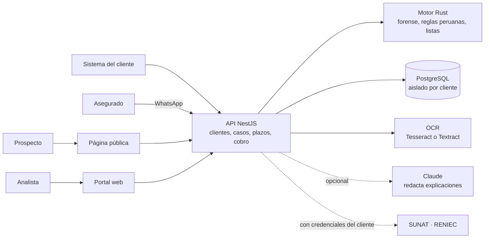

**El motor Rust mide; las reglas deciden; Claude solo redacta.** Así cada decisión se puede
explicar y auditar, como pide la SBS para el riesgo de modelo. El porqué de Rust y NestJS está en
[arquitectura.md](arquitectura.md).

## Cómo se probó

### Qué prueban y qué no

- **Sí prueban** que cada regla hace lo que se escribió: el puntaje, los plazos SBS, el aislamiento
  entre clientes, la auditoría, el MRZ y el dígito del CUI.
- **No prueban** que Ukuk detecte fraudes reales. Los documentos de muestra los hicimos nosotros
  pensando en las reglas que ya existen, así que detectarlos es circular.
- **Primera medición sin ayuda**, con `node demo/evaluar.mjs` y sin los datos que declara el
  cliente:
  - la boleta retocada salió **aprobar**: el monto pegado en la imagen no se vio;
  - el DNIe alterado salió marcado, pero por falsas alarmas de diseño, no por el número cambiado.
- **Lo que falta para detectar fraude real:** comparar letra por letra (forma, grosor, nitidez y
  ruido de fondo de cada campo frente al resto del documento) y tener plantillas de cada formato.
  Hoy solo hay revisiones genéricas (compresión, clonado, tamaño de palabra).

### Medición con documentos reales

Un conjunto de documentos reales con fraude confirmado (no está en el repositorio: se evalúa en
local con `demo/evaluar.mjs` y solo se guardan cifras).

**Actas de nacimiento: 167 documentos, 21 con fraude confirmado.**

| | Primera corrida | Tras quitar el ruido |
|---|---|---|
| Actas legítimas con alarma | 97 % | **1 %** |
| Fraudes confirmados marcados | 21 de 21, pero por ruido | **1 de 21** |

El "100 %" de la primera corrida no valía nada: el sistema marcaba casi todo. Al quitar el ruido
quedó a la vista la verdad: **hoy Ukuk no detecta esas adulteraciones**. El ruido venía de dos
errores, ya corregidos:
- La huella de imagen de 64 bits solo capta el diseño del formulario: 33 actas legítimas tenían
  la misma huella que otra acta distinta. Ahora, en documentos con texto, el reuso exige que
  también coincidan sus números (fechas, DNI, número de acta).
- La revisión de diseño genérica marcaba los cambios de tamaño propios del formulario. Ahora solo
  corre en comprobantes.

**DNI: 435 imágenes, sin etiquetas de fraude.**
- Con la lectura automática del MRZ y del número, el OCR local leyó datos en 35. En 26 el MRZ
  tenía todos sus dígitos válidos, y se encontraron 2 dígitos de CUI que no cuadran, 1 número
  distinto del MRZ y 4 DNI vencidos. Las alertas leídas por OCR van a "revisar" porque pueden ser
  errores de lectura.
- El OCR local no lee 3 de cada 4 anversos: hace falta Textract y recortar el carnet.

### Pruebas automáticas

| Parte | Pruebas | Resultado |
|---|---|---|
| Motor Rust (reglas peruanas, forense, nombres, API HTTP) | 163 | ✅ todas pasan · clippy sin avisos |
| API: pruebas unitarias (puntaje, plazos SBS, conversación, cifrado, CSV…) | 120 | ✅ todas pasan |
| API: de punta a punta contra PostgreSQL real (los 4 servicios, aislamiento entre clientes, auditoría) | 38 | ✅ todas pasan |
| Web (tipos y compilación) | — | ✅ sin errores |

Cómo correrlas: `cargo test --workspace` en `engine/`, y `npm test` y `npm run test:e2e` en `api/`.

### Prueba con los datos de demostración

Ojo: aquí el script de demostración le entrega a Ukuk los datos impresos (montos, DNI y MRZ).
Las detecciones salen de cruzar esos datos, no de mirar la imagen.

| Documento de muestra | Resultado | Por qué |
|---|---|---|
| Boleta legítima | ✅ aprobar (riesgo 9) | Nada relevante |
| La misma boleta, retocada | ⛔ rechazar (77) | Subtotal + IGV no da el total; la imagen es casi igual a otra ya presentada |
| DNIe con el número cambiado | ⚠️ revisar (66) | El dígito del CUI no corresponde al número; el MRZ trae otro número |
| DNI azul de la misma persona | ⚠️ revisar (33) | Vencido |

Los cuatro servicios también se probaron de punta a punta con `node demo/seed.mjs`:
- **PLAFT:** de 6 personas, 3 coincidieron con las listas y abrieron caso.
- **Radar:** 3 normas, de las cuales la particular se ignoró.
- **Siniestros:** una conversación completa por el simulador, con foto en vivo.

### Prueba con DNI reales

El fundador probó con fotos de su propio DNIe (frente y reverso) y de su DNI azul anterior. **Las
fotos y los datos no se guardaron en el repositorio:** las pruebas automáticas usan números
inventados. Esto es lo que se encontró:

| Qué pasó | Qué se cambió |
|---|---|
| Una foto con el DNI sostenido en la mano salió **"aprobar" sin haber leído nada** (el OCR no encontró texto) | Si no se puede leer, el sistema pide otra foto y no aprueba |
| El MRZ trae **solo el primer apellido** (en los dos DNI reales), y el sistema lo marcaba como discrepancia | Se acepta el primer apellido completo; un apellido distinto o cortado sigue siendo discrepancia |
| El CUI tiene un **dígito de verificación** (por ejemplo 12345678-**1**) que el sistema no revisaba | Nueva verificación: un número alterado no calza con su dígito |
| En un carnet, el CUI grande junto a etiquetas pequeñas parecía "letra de otro tamaño" | La revisión de diseño genérica no se aplica a carnets; ahí vale la plantilla |
| Los rellenos `<<<<` del MRZ parecían "zonas clonadas" | Se ignoran las repeticiones dentro de la franja del MRZ |
| Un DNI vencido quedaba con severidad media | Vencido = severidad alta: siempre se revisa |

Mientras no esté activa la API de Claude, la "IA" se simuló: Claude Code revisó las fotos y
escribió la explicación con el mismo formato que daría la API. Quedó guardada en el informe y
marcada como simulación.

### Otros problemas que encontraron las pruebas

| Problema | Arreglo |
|---|---|
| Una boleta legítima se rechazaba porque las filas repetidas de la tabla parecían clonadas | El texto repetido en la misma fila o columna es severidad baja |
| Las tildes en mayúsculas (CLÍNICA) parecían letras de otro tamaño | Más tolerancia en etiquetas; solo pesan las palabras con números |
| Las claves de SUNAT y RENIEC de cada cliente se guardaban en texto plano | Ahora se referencian por variable de entorno (`*_ref`) |
| La boleta de ejemplo usaba el RUC de un banco real | Se cambió por un RUC ficticio con dígito verificador válido |

## Qué sigue

### Fase 0: validación (ahora)

- [ ] Revisar el contrato laboral con un abogado (exclusividad, propiedad intelectual, no competencia).
- [ ] 10 entrevistas: 3 aseguradoras medianas o corredores, 3 cajas o cooperativas, 2 inmobiliarias
      o casas de cambio, 2 oficiales de cumplimiento.
- [ ] Conseguir unos 200 documentos reales anonimizados, con acuerdo de confidencialidad, para
      medir la detección.
- [ ] Carta de intención para un piloto pagado. **Esta es la condición para pasar a la fase 1.**
- [ ] **Medir la detección real** con documentos con fraude confirmado: `node demo/evaluar.mjs
      <carpeta> --tipo acta --etiquetas etiquetas.csv` (solo imprime cifras).
- [x] Demo lista para mostrar (`./dev.sh` + `node demo/seed.mjs`).
- [x] Guía de venta y guion de demo: [venta.md](venta.md).

### Fase 1: primer piloto (documental)

- [ ] **Forense de glifos:** comparar cada letra con las demás del mismo documento, y detectar
      campos con otra nitidez, otro ruido de fondo u otra cuadrícula de compresión.
- [ ] Tipos propios para actas de nacimiento, matrimonio y defunción, con sus reglas de fechas y
      plantillas por formato.
- [x] DNI con los dos lados en una imagen: el MRZ y el número del frente se leen con OCR y se
      cruzan solos.

- [ ] Desplegar en AWS en la región acordada, con dominio y correo propios.
- [ ] Activar Claude (`ANTHROPIC_API_KEY`) y Amazon Textract: Tesseract no lee bien las fotos de
      un carnet en la mano.
- [ ] Recortar y enderezar el documento dentro de la foto antes del OCR.
- [ ] Comparar los montos y datos declarados con lo que leyó el OCR. Hoy solo se cruzan los datos
      declarados entre sí.
- [ ] Plantillas del DNIe 3.0, el DNI azul y los emisores frecuentes del cliente.
- [ ] Probar SUNAT y RENIEC con las credenciales del cliente piloto.
- [ ] Usuarios con contraseña o SSO y roles en el portal. Hoy se entra con la llave de API del
      cliente.
- [ ] Medir detección y falsos positivos con sus documentos, y ajustar umbrales.

### Fase 2: PLAFT y radar

- [ ] Base propia de PEP peruanos (El Peruano, Infogob, Contraloría).
- [ ] Fuente real de noticias negativas.
- [ ] Autorización de Editora Perú para leer normas automáticamente.
- [ ] Revisión masiva en cola, para carteras grandes.

### Fase 3: siniestros con una aseguradora

- [ ] Número de WhatsApp Business de la aseguradora y plantillas aprobadas por Meta.
- [ ] Detectar reuso entre las fotos de siniestros y los documentos ya presentados.
- [ ] Días hábiles y feriados en los plazos SBS; confirmar la lectura de los plazos con un abogado.
- [ ] Transcripción de notas de voz y cola durable para el webhook.

### En paralelo

- [x] Aislamiento por cliente, cifrado y auditoría inalterable.
- [ ] Camino a ISO 27001 o SOC 2.
- [x] Límite de tasa en las rutas públicas (formulario y página de captura).
- [x] Archivos para el servidor: [docs/despliegue.md](despliegue.md).

## Probarlo tú mismo

```bash
./dev.sh               # PostgreSQL en Docker; motor, API y web en tu Mac
node demo/seed.mjs     # en otra terminal: datos de demostración; imprime la llave del portal
```

Abre http://localhost:5173. Ahí está la página pública con la demo, y con "Ingresar" entras al
portal usando la llave que imprimió el script.
