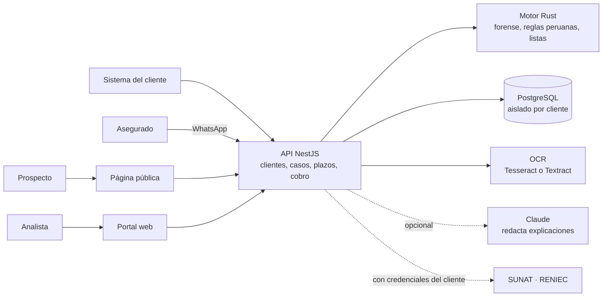

# Roadmap de Ukuk: qué está hecho, cómo se probó y qué sigue

*Actualizado: 13 de octubre de 2026.*

## En 30 segundos

- **Qué es:** cuatro servicios antifraude y de cumplimiento para seguros, banca, cajas y otros
  sujetos obligados en el Perú: verificación documental, PLAFT, radar regulatorio y siniestros por
  WhatsApp.
- **Dónde estamos:** el software de los cuatro servicios ya existe como **prototipo funcional y
  probado**, con página pública, portal para analistas y datos de demostración. Corre en tu Mac
  con un comando.
- **Lo que falta no es técnico:** el negocio está en la fase 0 de la propuesta (validar con
  clientes). Lo siguiente es revisar tu contrato laboral, hacer las 10 entrevistas y conseguir una
  carta de intención para un piloto pagado.


✓ = hecho y probado como prototipo · ○ = pendiente

## Lo que se construyó

### Etapa 1: los cuatro servicios

<!-- CAPTURAS -->

| Servicio | Qué hace hoy | Dónde está |
|---|---|---|
| **1. Verificación documental** | Recibe una imagen, PDF o XML y devuelve un puntaje de riesgo de 0 a 100, una decisión (aprobar, revisar, rechazar) y cada hallazgo marcado sobre el documento. Detecta zonas pegadas o clonadas, compresión distinta, edición con Photoshop, PDF modificado, sumas e IGV que no cuadran, MRZ del DNI que no coincide con lo impreso, y archivos o fotos reusados. | `engine/` (mediciones) y `api/src/documents` |
| **2. Radar regulatorio** | Separa normas generales de particulares, las cruza con los procesos internos del cliente y arma la matriz de impacto, el resumen diario, las tareas y el borrador de comentarios. | `api/src/regulatory` |
| **3. PLAFT** | Revisa personas y empresas contra OFAC, ONU y listas PEP, pensado para nombres peruanos. Abre casos, asigna el régimen de debida diligencia, guarda la decisión con su sustento y vuelve a revisar la cartera cada noche. | `engine/crates/ukuk-names` y `api/src/plaft` |
| **4. Siniestros por WhatsApp** | Conversación guiada, fotos en vivo con GPS y hora, plazos de la SBS (aviso, aclaraciones, consentimiento) y revisión del analista antes del ajustador. | `api/src/claims` |

Debajo de los cuatro hay una base común: cada cliente solo ve sus datos (aislamiento en la base de
datos), sus archivos se cifran con una llave propia, la auditoría no se puede borrar ni editar y se
mide el consumo para cobrar.

### Etapa 2: para probarlo y venderlo

| Pieza | Para qué sirve |
|---|---|
| **Página pública** con demo interactiva y formulario "Solicitar un piloto" | Que un prospecto entienda la oferta y deje sus datos |
| **Portal para analistas** con los cuatro servicios | Probar todo sin usar la terminal |
| **Inspector araña** | La animación que recorre el documento mientras se analiza: luce en una demo y sirve de barra de progreso |
| **Simulador de WhatsApp** | Probar el bot de siniestros sin cuenta de Meta |
| **OCR local con Tesseract** | Leer el texto de las imágenes gratis, sin AWS |
| **Datos de demostración** (`demo/`) | Boletas, un DNI, pólizas, procesos, normas y personas, todo ficticio |
| **`./dev.sh`** | Levanta todo en tu Mac con un comando |
| **Guías** | [Cómo vender](venta.md) y [cómo activar cada integración](integraciones.md) |

## Cómo funciona por dentro



- **El motor Rust mide; las reglas deciden; Claude solo redacta.** Así cada decisión se puede
  explicar y auditar, como pide la SBS para el riesgo de modelo.
- **Por qué Rust y NestJS:** el detalle está en [arquitectura.md](arquitectura.md).

## Cómo se probó

### Pruebas automáticas

<!-- PRUEBAS -->

### Prueba de punta a punta con datos de demostración

<!-- DEMO -->

### Problemas que las pruebas encontraron y se corrigieron

| Problema | Qué pasaba | Arreglo |
|---|---|---|
| Boleta legítima rechazada | Las filas de una tabla repiten texto ("Consulta médica") y parecían zonas clonadas | El texto repetido en la misma fila o columna cuenta como severidad baja; en documentos, un clonado de texto nunca pasa de severidad media |
| Boleta legítima en "revisar" | Al activar el OCR, las tildes de las mayúsculas (CLÍNICA) y las cajas algo holgadas parecían letras de otro tamaño | Más tolerancia en etiquetas; solo pesan las palabras con números, que son las que se adulteran |
| Nombres parciales sin coincidencia | "Teodulfo Huamanchumo" no coincide con "HUAMANCHUMO SARAVIA, Teodulfo Anselmo" con el umbral de 0.85 | Pendiente: revisar con el nombre completo del DNI o bajar el umbral por cliente |
| Credenciales en texto plano | Las claves de SUNAT y RENIEC de cada cliente se guardaban tal cual en la base | Ahora se referencian por variable de entorno (`*_ref`) |
| RUC real en los ejemplos | La boleta de ejemplo usaba el RUC de un banco real | Se cambió por RUC ficticios con dígito verificador válido |

## Qué sigue

### Fase 0: validación (ahora)

- [ ] Revisar el contrato laboral con un abogado (exclusividad, propiedad intelectual, no competencia).
- [ ] 10 entrevistas: 3 aseguradoras medianas o corredores, 3 cajas o cooperativas, 2 inmobiliarias
      o casas de cambio, 2 oficiales de cumplimiento.
- [ ] Conseguir unos 200 documentos reales anonimizados, con acuerdo de confidencialidad, para
      medir la detección.
- [ ] Carta de intención para un piloto pagado. **Esta es la condición para pasar a la fase 1.**
- [x] Demo lista para mostrar (`./dev.sh` + `node demo/seed.mjs`).
- [x] Guía de venta y guion de demo: [venta.md](venta.md).

### Fase 1: primer piloto (documental)

- [ ] Desplegar en AWS en la región acordada con el cliente, con dominio y correo propios.
- [ ] Probar SUNAT y RENIEC con las credenciales del cliente piloto.
- [ ] Medir detección y falsos positivos con sus documentos; ajustar umbrales.
- [ ] Biblioteca de plantillas de sus emisores frecuentes.
- [ ] Cola durable (SQS) para documentos pesados.

### Fase 2: PLAFT y radar

- [ ] Base propia de PEP peruanos (El Peruano, Infogob, Contraloría).
- [ ] Fuente real de noticias negativas.
- [ ] Autorización de Editora Perú para leer normas automáticamente.
- [ ] Revisión masiva en cola, para carteras grandes.

### Fase 3: siniestros con una aseguradora

- [ ] Número de WhatsApp Business de la aseguradora y plantillas aprobadas por Meta.
- [ ] Días hábiles y feriados en los plazos SBS; confirmar con un abogado la lectura de los plazos.
- [ ] Transcripción de notas de voz.

### En paralelo

- [x] Aislamiento por cliente, cifrado, auditoría inalterable.
- [ ] Camino a ISO 27001 o SOC 2.
- [ ] Límite de tasa en las rutas públicas (formulario y página de captura).

## Probarlo tú mismo

```bash
./dev.sh               # PostgreSQL en Docker; motor, API y web en tu Mac
node demo/seed.mjs     # en otra terminal: datos de demostración; imprime la llave del portal
```

Abre http://localhost:5173: la página pública con la demo, y "Ingresar" para el portal.
